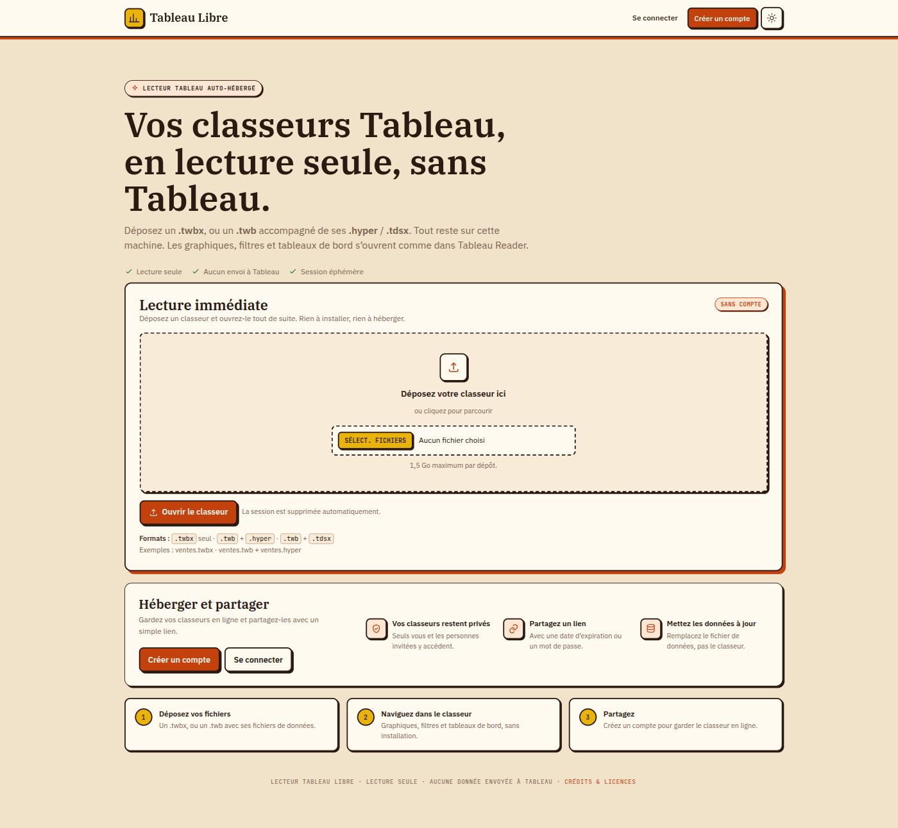

# Tableau Libre

<p align="center">
  
</p>

Lecteur et hébergeur auto-hébergé de classeurs Tableau. Il ouvre un `.twbx`, ou
un `.twb` accompagné de ses `.hyper` / `.tdsx`, dans le navigateur, sans Tableau
installé. Les fichiers restent sur votre serveur.

Deux usages : lecture immédiate sans compte, ou hébergement avec comptes, liens
de partage, protection par mot de passe, whitelist IP et API.

## Démarrage rapide

### Docker

```bash
git clone git@github.com:dbwa/tableau-libre.git
cd tableau-libre
cp .env.example .env
docker compose up -d --build
```

Ouvrir <http://127.0.0.1:8000>. Les données sont conservées dans `./data/`.

Pour un accès HTTPS derrière un reverse proxy, renseigner dans `.env` :

```dotenv
PUBLIC_BASE_URL=https://tableau-libre.mondomaine.fr
COOKIE_SECURE=1
TRUST_PROXY=1
```

### En local

```bash
git clone git@github.com:dbwa/tableau-libre.git
cd tableau-libre
python3 -m venv .venv
.venv/bin/pip install -r requirements.txt
./scripts/fetch_vendor.sh
cd app
../.venv/bin/python -m uvicorn main:app --host 127.0.0.1 --port 8000
```

Ouvrir <http://127.0.0.1:8000>.

Le premier compte créé est administrateur. Les données locales sont dans
`data/` et ne sont pas versionnées.

## Prérequis

- Python **3.11+** (3.12 recommandé) ;
- `curl` pour télécharger les bibliothèques JavaScript et les polices ;
- Docker et Docker Compose si vous utilisez la version conteneurisée ;
- environ 2 Go d’espace disque pour les dépendances et les fichiers.

## Technologies

- **Python / FastAPI / Uvicorn** pour le serveur et l’API ;
- **Tableau Hyper API** pour lire les extraits `.hyper` ;
- **Vega-Lite** et **MapLibre GL JS** pour les graphiques et les cartes ;
- **SQLite** pour les comptes, les classeurs et les partages.

Les bibliothèques JavaScript et les polices sont téléchargées à l’installation
par `scripts/fetch_vendor.sh` ; elles ne sont pas versionnées.

## Formats acceptés

- `.twbx` seul ;
- `.twb` + `.hyper` ;
- `.twb` + `.tdsx`.

Les connexions live et le format `.tde` ne sont pas supportés.

## Licences

Le code du projet est sous **licence MIT** : voir [`LICENSE`](LICENSE).

Les composants tiers conservent leurs licences respectives. Les textes et
notices sont dans [`THIRD_PARTY_NOTICES.md`](THIRD_PARTY_NOTICES.md) et
[`licenses/`](licenses/). La Tableau Hyper API est sous Apache-2.0 ; les polices
IBM Plex et JetBrains Mono sont sous SIL OFL 1.1.

---

Oui ce projet est 100 % vibe codé.